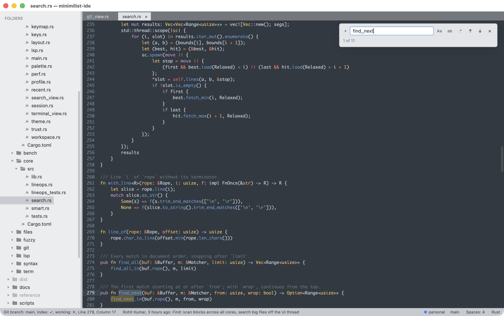
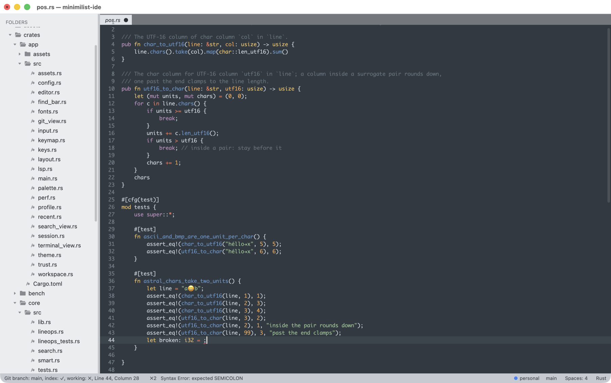
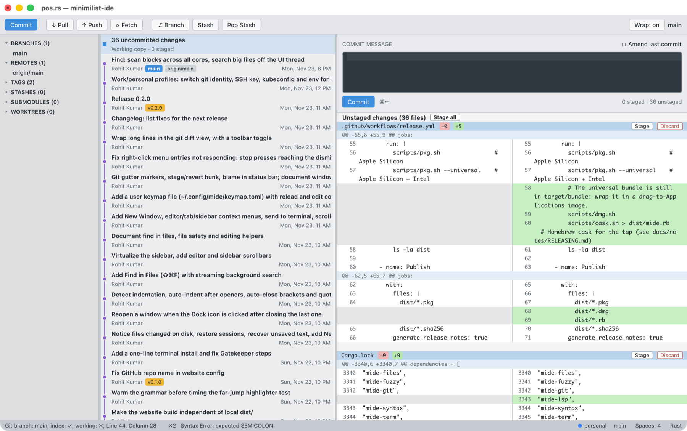
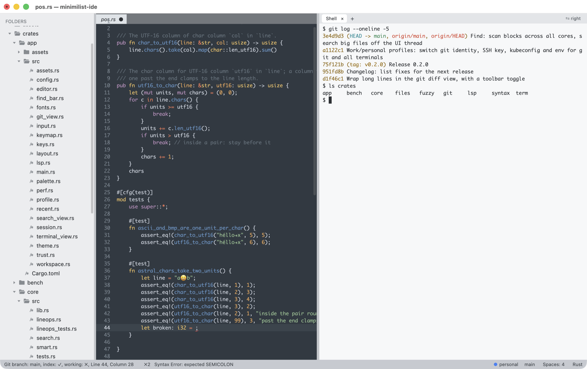
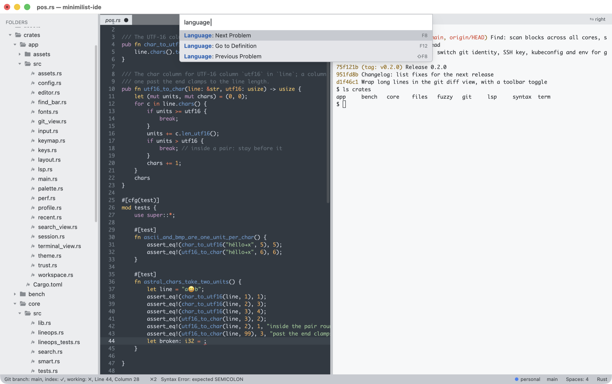

<p align="center">
  
</p>

<h1 align="center">mide</h1>

<p align="center">
  A native code editor for macOS, written in Rust.<br>
  Sublime-style speed, with git history and terminal sessions in the same window.
</p>

<p align="center">
  <a href="https://github.com/kmr-rohit/mide/releases/latest"><b>Download</b></a> &nbsp;|&nbsp;
  <a href="https://kmr-rohit.github.io/mide/">Documentation</a> &nbsp;|&nbsp;
  <a href="https://kmr-rohit.github.io/mide/performance.html">Benchmarks</a>
</p>

---

## What it is

* **An editor that stays out of the way.** A rope-backed buffer, multi-cursor editing, regex find and replace, the common line commands, and Sublime-style shortcuts. Syntax colors come from Sublime syntax definitions.
* **Git without leaving the window.** A commit graph, side-by-side diffs, and staging, commit, push, pull, branches and stash, using your own `git`, credentials and hooks.
* **Terminals that dock anywhere.** Real sessions for your shell, Claude Code and GitHub Copilot, in a panel you can drag to the bottom, left or right.
* **Language servers.** Errors and warnings as you type, go to definition with `F12` or `⌘`-click, using the server you already have installed (rust-analyzer, gopls, clangd, typescript-language-server, pyright and more).
* **Native.** Written in Rust and drawn on the GPU with [GPUI](https://www.gpui.rs/). No web view, no Electron. Light and dark themes, saved layout, a command palette, and go-to-file.

## A tour

Every screenshot below is mide working on its own source code.

### The editor



* **Multi-cursor editing.** `⌘D` adds the next match as another cursor, `⌃⌘G` selects every occurrence, and `⌥`-click adds a cursor where you click.
* **Find and replace** with case, whole-word and regular-expression options, `$1` captures in replacements, and a chevron that opens the replace row. **Find in files** (`⇧⌘F`) streams results as you type and honors `.gitignore`.
* **Line commands:** duplicate (`⇧⌘D`), delete (`⌃⇧K`), move (`⌃⌘↑` / `⌃⌘↓`), join (`⌘J`), indent, and toggle comment (`⌘/`).
* **Go to anything:** files with `⌘P`, lines with `⌃G`, and every command with the palette (`⇧⌘P`).
* **Safe by default:** files changed on disk are noticed, tabs and caret positions come back after a restart, unsaved text survives a crash, and binary files are refused.

### Language servers



* mide starts the language server you have installed for the file's language: `rust-analyzer`, `typescript-language-server`, `pyright`, `gopls`, `clangd`, `zls`, `sourcekit-lsp` or `bash-language-server`. If one is missing, it tells you the install command.
* Errors and warnings appear as **wavy underlines**, with a count in the status bar (click it to jump to the next problem) and the message when the caret is on one.
* **Go to definition** with `F12` or `⌘`-click. Step through problems with `F8` and `⇧F8`.
* Which problems appear, and when, is up to the server. For Rust, syntax errors show as you type; compiler errors come from `cargo check`, which `rust-analyzer` runs when you save.
* Not built yet: code completion and hover documentation. Turn the whole feature off with `language_servers = false` in `config.toml`.

### Git, without leaving the window



* A **commit graph**, side-by-side diffs that wrap long lines, and staging, commit, amend, push, pull, fetch, branches, stash and cherry-pick, using your own `git`, credentials and hooks.
* In the editor itself: **gutter markers** for added, modified and deleted lines, **Stage Hunk** and **Revert Hunk** from the right-click menu, and the **blame** of the current line in the status bar.
* Your git identity can follow a **work or personal profile** you switch from the status bar.

### A native terminal



* Real terminal sessions on a PTY: your shell, **Claude Code** and **GitHub Copilot** as profiles, or anything you configure.
* **Dock the panel** at the bottom, left or right by dragging it. Mouse support, scrollback and a proper emulator, not a web view.
* **Send Selection to Terminal** and **Send File Path** paste into the session without running anything, so you can hand a snippet or `@file` reference to an agent.

### The command palette



Everything above is a command with a shortcut. `⇧⌘P` lists them all, and `~/.config/mide/keymap.toml` rebinds any of them.

## Fast, and measured

| | |
|---|---|
| Work per keystroke | 4.6 ms (frame budget 16 ms) |
| Open a 1,000,000-line file | 65 ms |
| Find a match at the very end of that file | under 1 ms |
| Jump to line 100,000 with colors | 12 ms |
| CPU when idle | under 1% |

Measured on one Apple Silicon Mac with a release build. Every number is reproducible with `scripts/perf.sh`; the full results and methodology are on the [performance page](https://kmr-rohit.github.io/mide/performance.html).

## How it compares

| | mide | Zed | Sublime Text | VS Code |
|---|---|---|---|---|
| Native, GPU-drawn (no Electron) | yes | yes | native, own renderer | no (Electron) |
| Git graph and diffs in the window | yes | git panel | plugins | built in, extensions for more |
| Terminal and Claude Code / Copilot sessions | yes, as profiles | yes, plus its own agents | no | terminal; Copilot built in |
| Language server | errors and go to definition; **no completion yet** | yes | via plugins | yes |
| Extensions | **no** | yes | yes | largest ecosystem |
| Platforms | **macOS only** | macOS, Linux, Windows | all | all |

mide is the better fit if you want a small, fast editor with git and terminals built in, and you can live without language-server features. If you rely on completion, go to definition or extensions today, use one of the others for now. The [roadmap](https://kmr-rohit.github.io/mide/roadmap.html) says what is coming.

## Install

One command, on Apple Silicon or Intel:

```sh
curl -fsSL https://raw.githubusercontent.com/kmr-rohit/mide/main/scripts/install.sh | sh
mide ~/code/my-project
```

It downloads the latest release, checks its checksum, installs `mide.app` and adds the `mide` command. macOS does not show the unverified-developer warning for files fetched this way. Releases that ship a disk image install without a password; older ones use the installer package and ask for it. Remove it with `sh install.sh --uninstall` (download the script first), or see the [install guide](https://kmr-rohit.github.io/mide/install.html).

Prefer to click? Download the `.dmg` (drag to Applications) or the `.pkg` from the [latest release](https://github.com/kmr-rohit/mide/releases/latest). Neither is notarized yet, so macOS says it "could not verify" the download: choose **Done**, then **System Settings → Privacy & Security → Open Anyway**.

## Build from source

You need Rust and the full Xcode app (the GPU interface compiles Metal shaders).

```sh
xcodebuild -downloadComponent MetalToolchain   # once, after installing Xcode
cargo run --release -p mide -- .

scripts/bundle.sh --install    # build mide.app and copy it to /Applications
scripts/pkg.sh                 # build the installer into dist/
scripts/perf.sh --quick        # benchmarks (about a minute)
cargo test --workspace         # about 150 tests
```

If `cargo build` cannot find the `metal` compiler, point it at full Xcode with
`sudo xcode-select -s /Applications/Xcode.app/Contents/Developer` (or set `DEVELOPER_DIR`).

## Repository map

| Path | What is in it |
|---|---|
| `crates/core` | text buffer, undo, find and replace, line commands |
| `crates/syntax` | syntax highlighting and the editor theme |
| `crates/files` | sidebar tree, file index, file watcher |
| `crates/git` | git reading (libgit2) and git operations |
| `crates/fuzzy` | fuzzy matching for go-to-file and the palette |
| `crates/term` | terminal emulation on a PTY |
| `crates/app` | the interface (the `mide` binary) |
| `crates/bench` | benchmarks with budgets |
| `site-src/`, `docs/` | the website source and its generated pages (GitHub Pages serves `docs/`) |
| `scripts/` | bundle, installer, performance and license scripts |

## Publishing and releasing

See [docs/notes/RELEASING.md](docs/notes/RELEASING.md). The website is plain HTML built by `python3 site-src/build.py`.

## License

MIT, see [LICENSE](LICENSE). Third-party licenses: [THIRD_PARTY_LICENSES.md](THIRD_PARTY_LICENSES.md). mide is an independent project, not affiliated with Sublime HQ, Zed, GitHub or Anthropic.
